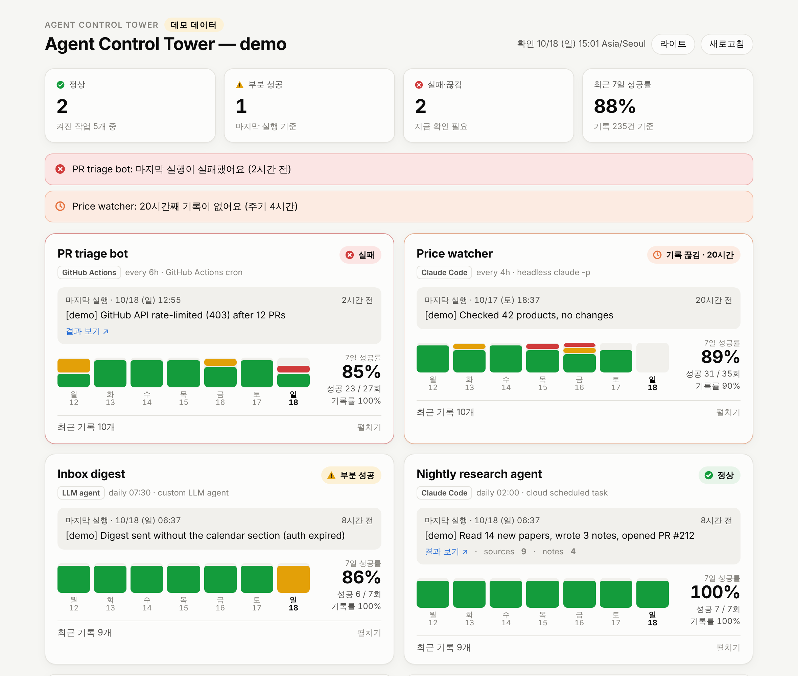

<h1 align="center">Agent Control Tower (에이전트 관제탑)</h1>

<p align="center">
  <b>사람 없이 도는 AI 에이전트가 실패했는지, 조용히 멈췄는지 알려 줘요.</b><br>
  Claude Code 예약 작업, GitHub Actions, cron, 그 밖의 LLM 에이전트를 위한 데드맨 스위치 + 대시보드.<br>
  서버·DB·계정 없음: 기록은 git 저장소의 JSON Lines, 대시보드는 정적 페이지 한 장.
</p>

<p align="center">
  <a href="https://dongjushin-ai.github.io/agent-control-tower/?demo&lang=ko"><b>라이브 데모</b></a> ·
  <a href="#빠른-시작">빠른 시작</a> ·
  <a href="snippets/claude-code.ko.md">지시문 조각</a> ·
  <a href="docs/private-repos.md">비공개 저장소</a> ·
  <a href="README.md">English</a>
</p>

<p align="center">
  <a href="https://dongjushin-ai.github.io/agent-control-tower/?demo&lang=ko">
    
  </a>
  <br><sub>데모 데이터예요. 누르면 라이브 페이지가 열려요.</sub>
</p>

## 왜 필요한가

자는 동안 도는 에이전트는 두 가지 방식으로 실패해요.

1. **시끄럽게**: 실행은 끝났고 실패했다고 말해요. 결과를 다음에 열어 볼 때 알게 돼요.
2. **조용히**: 세션이 죽거나, 예약이 지워지거나, 토큰이 만료되거나, 러너가 아예 안 떠요. 아무 데도 기록이 없으니
   알아챌 거리도 없어요. 며칠 뒤에야 알아요.

대부분의 에이전트 모니터는 내 노트북에서 도는 세션을 실시간으로 봐요. 새벽 3시에 클라우드에서 도는 에이전트에는
소용이 없어요. 이 도구는 바로 그 경우를 위한 거예요.

- 실행마다 `tower/logs/<작업>.jsonl`에 **한 줄**을 남겨요 (프롬프트 끝의 지시문, 또는 명령을 `run`으로 감싸기)
- **감시(watchdog) 워크플로**가 GitHub의 시계로 매시간 돌면서, 실패했거나 주기보다 오래 조용한 작업이 있으면 빨갛게 실패해요.
  GitHub이 메일로 알려 줘요. 비밀값도, 다른 서비스도 필요 없어요
- **정적 대시보드**가 작업별 마지막 결과와 최근 7일을 보여 줘요. "끊김" 판정을 브라우저에서 시각으로 계산하기 때문에,
  배포가 멈춰도 그 사실이 화면에 드러나요

## 빠른 시작

```bash
# 기록을 둘 저장소에서 (기존 저장소, 또는 "agent-logs" 같은 작은 전용 저장소)
npx agent-control-tower init --workflows
git add tower .github && git commit -m "Add agent control tower" && git push
```

> 아직 npm에 없다면: `npx github:dongjushin-ai/agent-control-tower init --workflows`

에이전트마다 기록 방법을 골라요.

| 에이전트 | 할 일 |
| --- | --- |
| Claude Code 예약 작업 · 클라우드 세션 · `claude -p` | 프롬프트 끝에 [snippets/claude-code.ko.md](snippets/claude-code.ko.md) 붙이기 |
| 다른 LLM 에이전트 (Codex CLI, Aider, OpenHands, 직접 만든 루프) | [snippets/llm-agent.md](snippets/llm-agent.md) 붙이기, 또는 감싸는 스크립트에서 `log` 호출 |
| cron 스크립트 · systemd 타이머 | `npx agent-control-tower run --task backup --push -- ./backup.sh` ([snippets/cron.md](snippets/cron.md)) |
| GitHub Actions 작업 | `if: always()` 단계에서 `log` 호출 ([snippets/cron.md](snippets/cron.md#github-actions)) |

보기:

```bash
npx agent-control-tower status    # 터미널 요약, 실패·끊김이 있으면 종료 코드 2
npx agent-control-tower serve     # http://127.0.0.1:8787 에서 대시보드
```

상시 주소가 필요하면 GitHub Pages를 켜세요 (Settings > Pages > Source: **GitHub Actions**). `init --workflows`가 추가한
`tower-pages.yml`이 기록이 push될 때마다 대시보드를 배포해요.

## 동작 방식

```text
 에이전트 실행 ──(지시문 / run / log)──▶ tower/logs/<작업>.jsonl ──git push──▶ 저장소
                                                                               │
             ┌─────────────────────────────────────────────────────────────────┤
             ▼                                                                 ▼
  tower-watchdog.yml (매시간, GitHub 시계)                     tower-pages.yml (push 때)
  `status --markdown` → 작업 요약                              `build` → index.html + summary.json
  종료 코드 2 → 실패 표시 → GitHub 알림                         → GitHub Pages 대시보드
```

기록 한 줄:

```json
{"v":1,"task":"nightly-research","at":"2026-10-18T02:04:11Z","status":"ok","summary":"논문 14편 읽고 노트 3개 작성","metrics":{"notes":3}}
```

| 상태 | 뜻 |
| --- | --- |
| **정상** | 마지막 실행 `ok`, 주기 안에 기록 있음 |
| **부분 성공** | 마지막 실행 `warn` (일부만 함) |
| **실패** | 마지막 실행 `fail` |
| **기록 끊김** | `everyHours + 여유` 동안 기록 없음 (여유 기본값 `max(1시간, everyHours / 2)`, 또는 `graceHours`) |
| 기록 없음 / 꺼짐 | 한 번도 기록 없음 / `enabled: false` |

## 다른 도구와 비교

| | 실시간 세션 모니터<br><sub>ccmon, agents-observe, Claude-Code-Agent-Monitor 등</sub> | 사용량 대시보드<br><sub>CCDash 등</sub> | cron 모니터<br><sub>healthchecks.io, Cronitor, Dead Man's Snitch</sub> | **Agent Control Tower** |
| --- | --- | --- | --- | --- |
| 보는 것 | 내 컴퓨터에서 도는 세션, 실시간 | 토큰·한도·비용 | 작업별 핑 | 실행마다의 결과 |
| 내 컴퓨터 없이 클라우드·새벽에 | 안 됨 | 일부 | 됨 | **됨** |
| 아예 안 돈 실행을 알아챔 | 못 함 | 못 함 | **함** | **함** |
| "부분 성공"·요약·결과 링크 | 도구 호출은 보지만 결과는 아님 | 없음 | 없음 (핑 또는 실패) | **있음** |
| 필요한 것 | 로컬 프로세스나 서버 (훅, SQLite, WebSocket) | 로컬 백엔드 | SaaS 계정이나 서버 | **git 저장소** (Pages는 선택) |
| Claude 밖의 에이전트·일반 스크립트 | 대부분 Claude Code 전용 | Claude 전용 | 됨 | **됨** |

키보드 앞에 있을 때는 실시간 모니터를, 자리에 없을 때 도는 것에는 이 도구를. 비교는 2026년 10월 각 프로젝트의
공개 README 기준이에요. 틀린 곳은 알려 주세요.

## 비공개 저장소

감시 워크플로는 비공개 저장소에서도 돌고 아무것도 공개하지 않아요. 대시보드는 토큰 없이 세 가지 방법이 있어요:
클론에서 `serve`로 로컬 보기, `build --redact`로 Pages에 올리기 (Pages 사이트는 공개라서 이름·시각·상태만 나가요),
또는 저장소 권한이 있는 사람만 볼 수 있는 감시 워크플로의 작업 요약.
**페이지에 GitHub 토큰을 절대 넣지 마세요.** 자세히: [docs/private-repos.md](docs/private-repos.md)

## CLI

```text
npx agent-control-tower init    [--task <id> --name <이름> --every <시간>] [--workflows]
npx agent-control-tower log     --task <id> --status ok|warn|fail --summary "<한 줄>"
                                [--link <url>] [--metric 이름=숫자 ...] [--duration <초>] [--push]
npx agent-control-tower run     --task <id> [--summary <글>] [--push] -- <명령 ...>
npx agent-control-tower status  [--json | --markdown] [--fail-on fail,stale,warn,none] [--lang en|ko] [--offline]
npx agent-control-tower build   [--out _site] [--days 14] [--redact]
npx agent-control-tower serve   [--port 8787]
```

- 모든 명령에 `--dir <경로>` (기본 `./tower`, 또는 `tower/tower.config.json`이 있는 가장 가까운 상위 폴더, 환경 변수 `TOWER_DIR`)
- `log`는 API 키·토큰·비밀번호·개인 키·인증 정보가 든 URL처럼 보이는 요약과 링크를 거절해요
- `log --push`는 자기가 바꾼 파일만 커밋하고, 다른 에이전트가 먼저 push했으면 rebase 후 다시 시도해요. 강제 push는 안 해요
- `run`은 감싼 명령의 종료 코드로 끝나서 cron도 실패를 알 수 있어요

설정 형식, 대시보드 URL 옵션(`?demo`, `?lang=ko`, `?theme=dark`, `?data=`), 설계 원칙, 로드맵은
[영어 README](README.md#config)에 있어요.

## 라이선스

[MIT](LICENSE)
