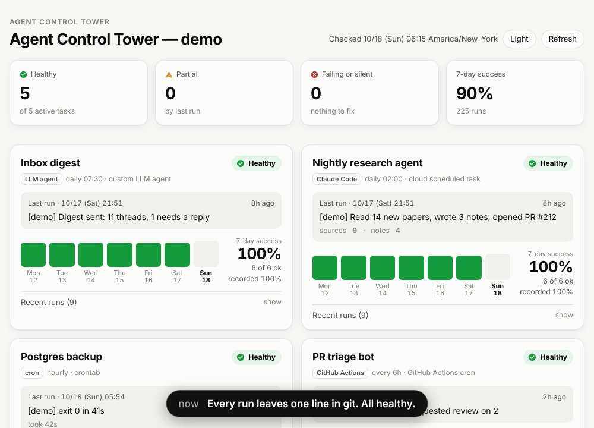
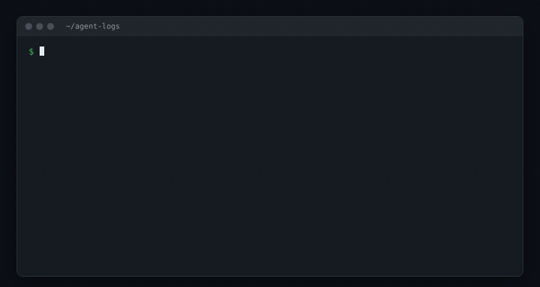

<h1 align="center">Agent Control Tower</h1>

<p align="center">
  <b>Know when your unattended AI agents fail, or silently stop running.</b><br>
  A dead-man's switch and dashboard for Claude Code scheduled tasks, GitHub Actions, cron jobs and any other LLM agent.<br>
  No server, no database, no account: logs are JSON Lines in your git repo, the dashboard is one static page.
</p>

<p align="center">
  <a href="https://dongjushin-ai.github.io/agent-control-tower/?demo">
    
  </a>
  <br><sub>Demo data, sped up. An agent dies without a word, its card turns "Silent". Click for the live page.</sub>
</p>

## Why

Agents that run while you sleep fail in two ways:

1. **Loudly.** The run finishes and says it failed. You find out whenever you next read its output.
2. **Silently.** The session crashes, the schedule gets deleted, the token expires, the runner never starts.
   Nothing is written anywhere, so there is nothing to notice. You find out days later.

Most agent monitors watch sessions running on your laptop in real time. That doesn't help when the agent runs in the cloud
at 3 a.m. Agent Control Tower is built for that case:

- every run appends **one line** to `tower/logs/<task>.jsonl` (a snippet at the end of the prompt, or `run` around a command)
- a **watchdog** GitHub Actions workflow runs on GitHub's clock and goes red when a task is failing or has been quiet longer
  than its schedule allows. GitHub emails you; no secrets or extra service needed
- a **static dashboard** shows every task, its last result and the last 7 days. It works out "silent" from timestamps in your
  browser, so it can't go stale without telling you

## Quick start

```bash
# in the repo that will hold the logs (an existing repo, or a small dedicated one like "agent-logs")
npx agent-control-tower init --workflows
git add tower .github && git commit -m "Add agent control tower" && git push
```

> Until the package is on npm, use `npx github:dongjushin-ai/agent-control-tower init --workflows` instead (same commands, fetched from GitHub).

Then pick how each agent records its runs:

| Your agent | Do this |
| --- | --- |
| Claude Code scheduled task / cloud session / `claude -p` | paste [snippets/claude-code.md](snippets/claude-code.md) at the end of the prompt |
| Any other LLM agent (Codex CLI, Aider, OpenHands, your own loop) | paste [snippets/llm-agent.md](snippets/llm-agent.md), or call `log` from the wrapper |
| A cron script or systemd timer | `npx agent-control-tower run --task backup --push -- ./backup.sh` ([snippets/cron.md](snippets/cron.md)) |
| A GitHub Actions job | an `if: always()` step that calls `log` ([snippets/cron.md](snippets/cron.md#github-actions)) |

Look at it:

```bash
npx agent-control-tower status    # terminal; exit code 2 if anything is failing or silent
npx agent-control-tower serve     # dashboard on http://127.0.0.1:8787
```

<p align="center">
  
</p>

For a permanent URL, turn on GitHub Pages (Settings > Pages > Source: **GitHub Actions**). The `tower-pages.yml` workflow
that `init --workflows` added publishes the dashboard on every log push.

## How it works

```text
 agent run ──(snippet / run / log)──▶ tower/logs/<task>.jsonl ──git push──▶ your repo
                                                                             │
             ┌───────────────────────────────────────────────────────────────┤
             ▼                                                               ▼
  tower-watchdog.yml (hourly, GitHub's clock)                 tower-pages.yml (on push)
  `status --markdown` → job summary                           `build` → index.html + summary.json
  exit 2 → red run → GitHub notification                      → GitHub Pages dashboard
```

A record is one line:

```json
{"v":1,"task":"nightly-research","at":"2026-10-18T02:04:11Z","status":"ok","summary":"Read 14 papers, wrote 3 notes","link":"https://github.com/me/notes/pull/212","metrics":{"notes":3}}
```

| State | Meaning |
| --- | --- |
| **Healthy** | last run `ok`, within schedule |
| **Partial** | last run `warn` (did some of the work) |
| **Failed** | last run `fail` |
| **Silent** | no record for `everyHours + grace` (grace defaults to `max(1h, everyHours / 2)`, or set `graceHours`) |
| No runs yet / Paused | never recorded / `enabled: false` |

## How it compares

| | Live session monitors<br><sub>ccmon, agents-observe, Claude-Code-Agent-Monitor and similar</sub> | Usage dashboards<br><sub>CCDash and similar</sub> | Cron monitors<br><sub>healthchecks.io, Cronitor, Dead Man's Snitch</sub> | **Agent Control Tower** |
| --- | --- | --- | --- | --- |
| Watches | sessions running on your machine, live | tokens, quota, cost | a ping per job | the outcome of each run |
| Runs in the cloud / at 3 a.m. without your machine | no | partly | yes | **yes** |
| Notices a run that never happened | no | no | **yes** | **yes** |
| Knows "partial", a summary, a result link | tool calls, not outcomes | no | no (ping or fail) | **yes** |
| Needs | local process or server (hooks, SQLite, WebSocket) | local backend | a SaaS account or a server | **a git repo** (Pages optional) |
| Works with non-Claude agents and plain scripts | mostly Claude Code only | Claude only | yes | **yes** |

Use a live monitor while you're at the keyboard, and this for everything that runs when you're not. Comparison based on the
projects' public READMEs as of October 2026. Corrections are welcome.

## Private repositories

The watchdog works in private repos and publishes nothing. For a dashboard you have three token-free options:
`serve` locally from a clone, `build --redact` to Pages (Pages sites are public, so only names, times and statuses go out),
or the job summary of the watchdog run, which only people with repo access can see.
**Never put a GitHub token into the page.** Details: [docs/private-repos.md](docs/private-repos.md).

## CLI

```text
npx agent-control-tower init    [--task <id> --name <name> --every <hours>] [--workflows]
npx agent-control-tower log     --task <id> --status ok|warn|fail --summary "<one line>"
                                [--link <url>] [--metric name=number ...] [--duration <sec>] [--push]
npx agent-control-tower run     --task <id> [--summary <text>] [--push] -- <command ...>
npx agent-control-tower status  [--json | --markdown] [--fail-on fail,stale,warn,none] [--lang en|ko] [--offline]
npx agent-control-tower build   [--out _site] [--days 14] [--redact]
npx agent-control-tower serve   [--port 8787]
```

- `--dir <path>` everywhere (default `./tower`, or the nearest parent folder that has `tower/tower.config.json`; env `TOWER_DIR`).
- `log` refuses summaries and links that look like API keys, tokens, passwords, private keys or URLs with credentials.
- `log --push` commits only the files it touched, rebases and retries when another agent pushed first, and never force-pushes.
- `run` exits with the wrapped command's exit code, so cron still sees the failure.

## Config

`tower/tower.config.json` ([full example](tower.config.example.json)):

```json
{
  "version": 1,
  "title": "My agents",
  "timezone": "America/New_York",
  "tasks": [
    { "id": "nightly-research", "name": "Nightly research agent", "kind": "claude-code", "schedule": "daily 02:00", "everyHours": 24 },
    { "id": "pr-triage", "name": "PR triage bot", "kind": "github-actions", "everyHours": 6, "graceHours": 2 },
    { "id": "elsewhere", "everyHours": 24, "source": { "url": "https://raw.githubusercontent.com/OWNER/REPO/main/tower/logs/elsewhere.jsonl" } }
  ]
}
```

`kind` is a label (`claude-code`, `llm-agent`, `github-actions`, `cron`, `other`). `source.url` reads a task's log from another
public location. `timezone` sets the calendar days of the 7-day strip (the dashboard otherwise uses the viewer's). The first
`log` for an unknown id adds the task with a 24 h schedule.

The dashboard accepts `?demo`, `?lang=ko`, `?theme=dark` and `?data=<url>` (a `summary.json`, or a folder that contains
`tower.config.json` and `logs/`, for example a raw.githubusercontent.com URL of a public repo).

## Design choices

- **Git is the database.** Every agent that can push already has the only credential it needs. History, diffs and blame come free.
- **One file per task.** Two agents logging at once almost never touch the same file, so rebases are trivial.
- **The page judges time, not the build.** Status is computed in the browser from timestamps, so a dead pipeline still shows up as silent.
- **Zero dependencies, zero external requests.** The page loads no fonts, CDNs or analytics. The CLI is one file.
- **Refuse secrets by default.** Logs often end up public; the cheapest leak to prevent is the one never written.

## Roadmap

- `doctor`: check a scheduled task end to end (repo access, push, config)
- cron-expression schedules (`"0 2 * * *"`) instead of `everyHours`
- metric sparklines and a 30-day view
- notifications beyond GitHub's own (Slack / Discord / ntfy webhook from the watchdog)
- adapters that read existing logs (GitHub Actions run history, `cycles.log`-style text logs)

Ideas and bug reports are welcome in [issues](https://github.com/dongjushin-ai/agent-control-tower/issues).

## Development

```bash
npm test                 # node --test, no install needed
npm run demo             # local server; open http://127.0.0.1:8787/?demo
npm run screenshot       # regenerates docs/assets/*.png (needs Playwright)
```

## License

[MIT](LICENSE)
